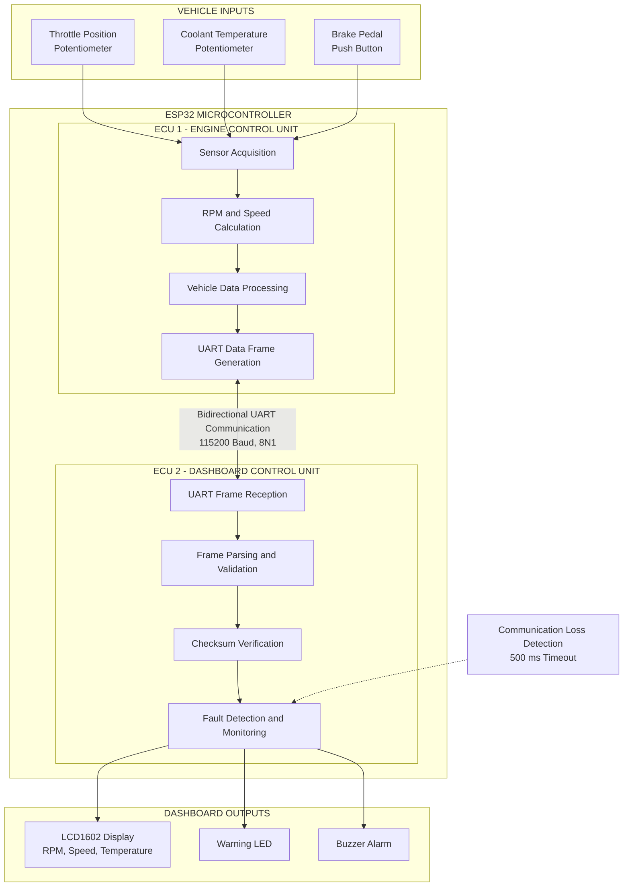
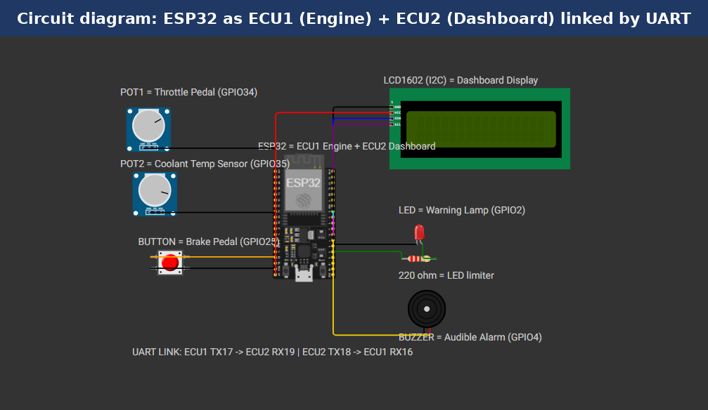
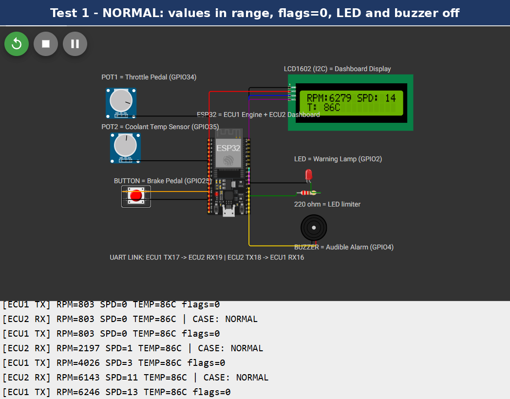
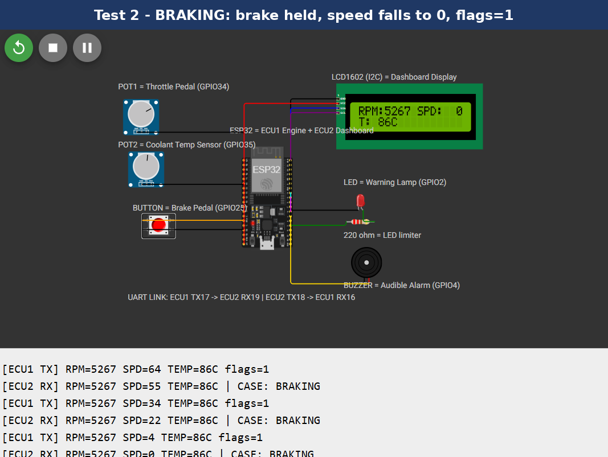
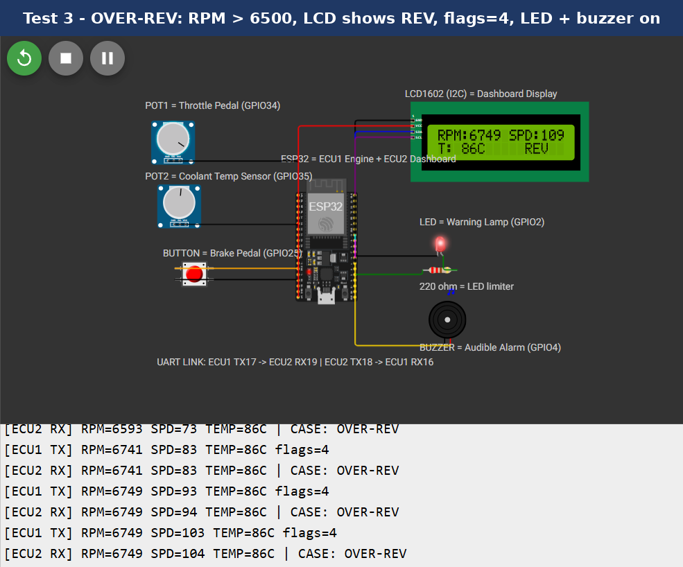
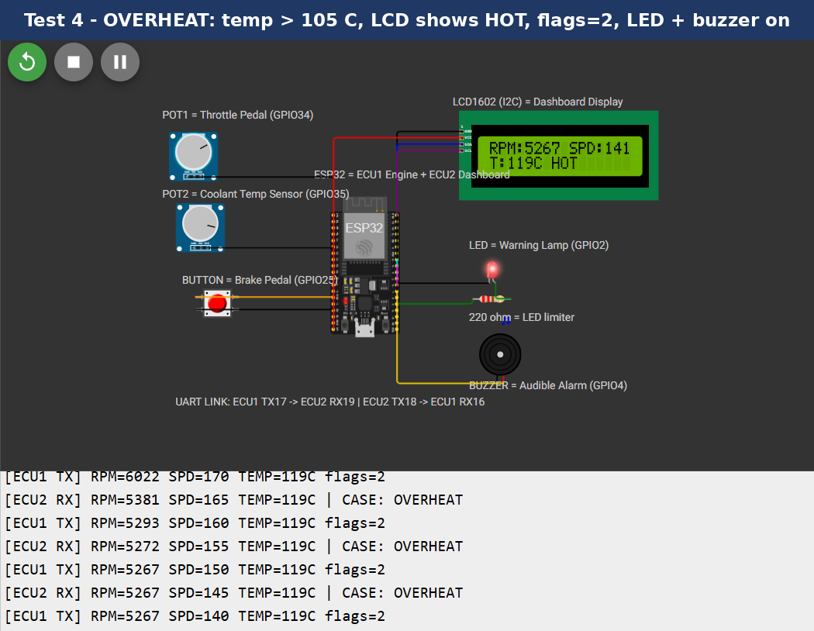
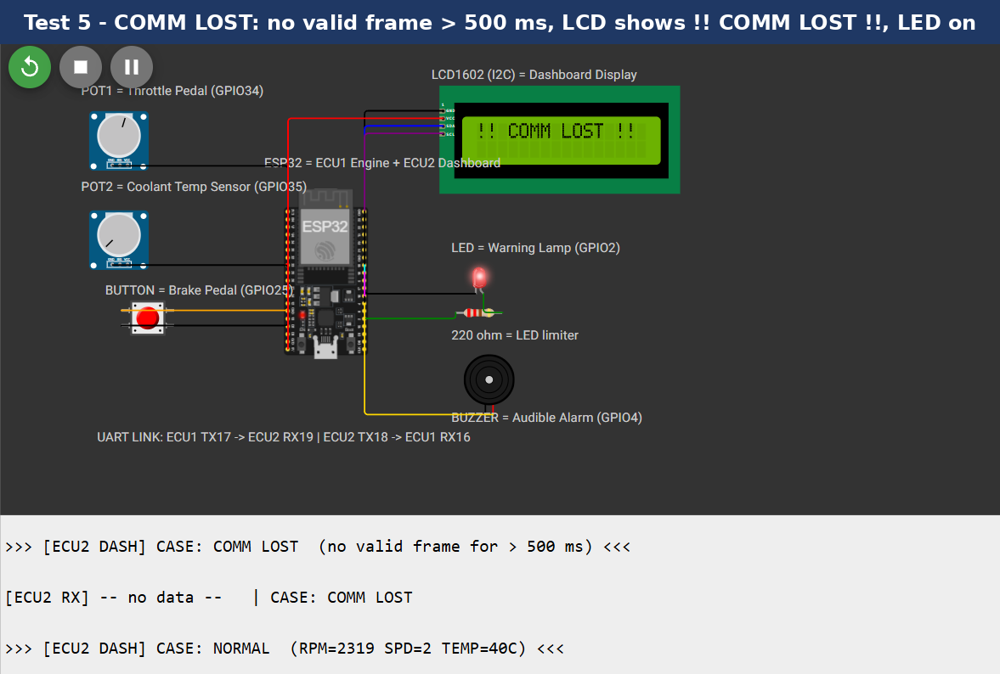

# ESP32-Based Automotive ECU Communication Simulator

A simulated automotive communication system in which two Electronic Control Units (ECUs) exchange vehicle data over **UART**, built and tested in the [Wokwi](https://wokwi.com) online simulator.

**Live demo:** https://wokwi.com/projects/481308240983782401

| ECU | Role |
|---|---|
| **ECU 1 - Engine Control Unit** | Reads throttle, coolant temperature and brake inputs, computes RPM and speed, and transmits a data frame every 100 ms |
| **ECU 2 - Dashboard Control Unit** | Receives and validates frames, shows the data on an LCD, and drives a warning LED and buzzer |

---

## Basics (read this first)

**What is an ECU?** An Electronic Control Unit is a small computer inside a vehicle that controls one job. A modern car has dozens (engine, brakes, dashboard, airbags). They constantly send data to each other over in-vehicle networks.

**What is UART?** A simple serial communication protocol that uses two wires, TX (transmit) and RX (receive), plus a common ground. One side's TX connects to the other side's RX. Both sides must use the same speed (baud rate). Here: 115200 baud, 8 data bits, no parity, 1 stop bit (8N1).

**What is a frame?** A fixed-format packet of bytes. Fixed start and end bytes let the receiver find where a message begins and ends, and a checksum lets it detect damaged data.

**What is a checksum?** An extra byte computed from the data. The sender adds it; the receiver recomputes it and compares. If the two differ, the frame is discarded. This project uses XOR of the data bytes.

**What is Wokwi?** A free online simulator for microcontrollers. You write the code, draw the circuit, and run it in the browser with no hardware.

**What is a FreeRTOS task?** A function that runs independently of other functions, like a separate program. The ESP32 can run several tasks at the same time. This project uses one task per ECU.

**Which sensor does what here?**

| Real vehicle part | Simulated by |
|---|---|
| Accelerator pedal | Potentiometer 1 |
| Coolant temperature sensor | Potentiometer 2 |
| Brake pedal switch | Push button |
| Instrument cluster | LCD1602 |
| Warning lamp | Red LED |
| Chime / alarm | Buzzer |

**Data flow in one sentence:** the engine ECU reads the pedals and sensor, packs the values into a frame, sends it over UART, and the dashboard ECU checks the frame, shows the values, and raises an alarm when something is wrong or when the frames stop arriving.

---

## Features
- Custom UART frame with start/end bytes, length field and **XOR checksum**
- Byte-by-byte frame parser on the dashboard (corrupted frames are rejected)
- **Communication-loss detection**: no valid frame for 500 ms raises an alarm
- Warning logic for overheat, over-rev and braking
- Audible alarm (2 kHz beeping buzzer) and warning LED
- Serial Monitor shows the exact case (`NORMAL`, `OVERHEAT`, `OVER-REV`, `BRAKING`, `COMM LOST`)
- Type `c` in the Serial Monitor to cut or restore the link at run time

## Architecture
## System Architecture

The proposed system consists of two logical Electronic Control Units (ECUs) implemented on a single ESP32 microcontroller using FreeRTOS tasks. The Engine Control Unit collects vehicle parameters and transmits structured data frames through UART. The Dashboard Control Unit receives, validates and processes the frames to monitor vehicle conditions and generate appropriate warnings.

### Architecture Diagram



### Internal UART Configuration

| Parameter | Configuration |
|---|---|
| Communication Protocol | UART |
| Baud Rate | 115200 |
| Data Format | 8N1 |
| ECU 1 TX | GPIO 17 |
| ECU 1 RX | GPIO 16 |
| ECU 2 TX | GPIO 18 |
| ECU 2 RX | GPIO 19 |
| Communication | Bidirectional |

**Implementation Note:** Both ECUs are simulated on one ESP32 using separate FreeRTOS tasks and hardware UART interfaces. The UART TX and RX connections establish an internal communication link between the two logical ECUs.

## Hardware (simulated)

| Component | Label in diagram | ESP32 pin |
|---|---|---|
| Potentiometer 1 | Throttle pedal | GPIO34 |
| Potentiometer 2 | Coolant temperature sensor | GPIO35 |
| Push button | Brake pedal | GPIO25 (to GND, internal pull-up) |
| LCD1602 (I2C) | Dashboard display | SDA = GPIO21, SCL = GPIO22 |
| LED + 220 ohm resistor | Warning lamp | GPIO2 |
| Buzzer | Audible alarm | GPIO4 |

**UART link between the two ECUs**

| From | To |
|---|---|
| ECU 1 TX (GPIO17) | ECU 2 RX (GPIO19) |
| ECU 2 TX (GPIO18) | ECU 1 RX (GPIO16) |

## Frame format

```
[0xAA][ID=0x01][LEN=5][RPM_H][RPM_L][SPEED][TEMP][FLAGS][XOR][0x55]
```

| Byte | Field | Description |
|---|---|---|
| 0 | Start | `0xAA` |
| 1 | ID | `0x01` (engine data) |
| 2 | Length | `5` payload bytes |
| 3-4 | RPM | 16-bit, high byte first |
| 5 | Speed | km/h |
| 6 | Temperature | degrees C |
| 7 | Flags | bit0 = brake, bit1 = overheat, bit2 = over-rev |
| 8 | Checksum | XOR of bytes 1 to 7 |
| 9 | End | `0x55` |

## Warning thresholds

| Condition | Trigger | flags value |
|---|---|---|
| Braking | Button held | 1 |
| Overheat | Temperature above 105 C | 2 |
| Over-rev | RPM above 6500 | 4 |
| Communication lost | No valid frame for more than 500 ms | n/a (detected on the dashboard) |

Flags add up when conditions combine (for example `6` = overheat + over-rev).

## How to run
1. Open the [Wokwi project](https://wokwi.com/projects/481308240983782401), or create a new **ESP32** project and copy `sketch.ino`, `diagram.json` and `libraries.txt` from this repository.
2. Press the green **Start** button.
3. Click a potentiometer and drag its slider, or hold the red button, to change conditions.
4. Watch the LCD, LED, buzzer and Serial Monitor.

## Test results

| # | Case | How triggered | Serial output | Result |
|---|---|---|---|---|
| 1 | Normal | Throttle raised, no faults | `CASE: NORMAL`, flags=0 | Pass |
| 2 | Braking | Brake button held | `CASE: BRAKING`, flags=1, speed falls to 0 | Pass |
| 3 | Over-rev | Throttle near maximum | `CASE: OVER-REV`, flags=4, LCD shows `REV` | Pass |
| 4 | Overheat | Temperature pot high | `CASE: OVERHEAT`, flags=2, LCD shows `HOT` | Pass |
| 5 | Communication loss | Type `c` in Serial Monitor | `CASE: COMM LOST`, LCD shows `!! COMM LOST !!` | Add screenshot |

Screenshots are in the `screenshots/` folder:








A test checklist is also available in `ECU_Test_Conditions.xlsx`.

## Repository structure

```
esp32-ecu-simulator/
├── sketch.ino                 Firmware (both ECUs)
├── diagram.json               Wokwi circuit
├── libraries.txt              LiquidCrystal I2C
├── ECU_Test_Conditions.xlsx   Test checklist
├── screenshots/               Test evidence
└── README.md
```

## Possible extensions
- CAN-style message ID table (RPM = 0x100, temperature = 0x200)
- UDS-style diagnostic request/response (service 0x22, read data by identifier)
- Diagnostic trouble codes (DTCs) stored in NVS, for example P0217 (overheat) and P0219 (over-rev)

## License
MIT
